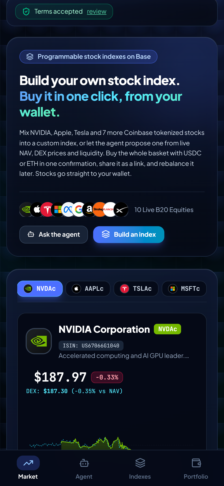
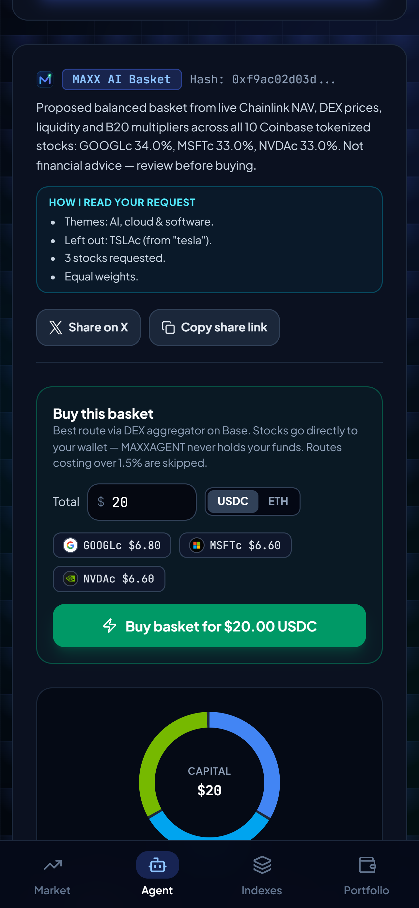
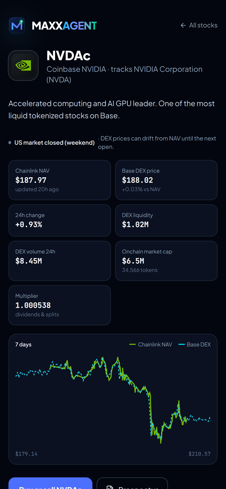

<p align="center"></p>

# MAXXAGENT

**Build your own index of Coinbase tokenized stocks on Base, or let an agent propose one, and buy it in one click from your own wallet.**

**Live:** [maxxagent.xyz](https://maxxagent.xyz) · also a Farcaster mini app · [Live stats](https://maxxagent.xyz/stats) · [How to verify](https://maxxagent.xyz/verify) · [FAQ](https://maxxagent.xyz/faq)

Built for the **Base Builder Quest: Stocks Maxxing Season** (Nov 5 – Dec 5, 2026), tracks **Agentic Stock Finance** and **Programmable Stock Markets**.

> Not financial advice. Coinbase tokenized stocks are only available to persons in eligible jurisdictions outside the United States. MAXXAGENT is an independent project and is not affiliated with, endorsed or sponsored by Base, Coinbase, Chainlink, KyberSwap, any Stocks Maxxing partner, or any referenced company. Tokens are not the shares themselves and give no shareholder rights beyond what the token provides.

<p align="center">
  
  
  
</p>

## What it does

| Feature | Details |
| --- | --- |
| **Build an index** | Pick up to 10 of the 10 Coinbase B20 stocks (NVDAc, AAPLc, TSLAc, MSFTc, METAc, GOOGLc, AMZNc, MSTRc, SNDKc, SPCXc), set weights with sliders, buy the whole basket at once, or share it as a link (`/?basket=NVDAc-40,MSFTc-30&amount=50`) |
| **Basket agent** | A transparent, rule-based agent reads a plain-language request — themes (AI, cloud, big tech, space, crypto…), named stocks, exclusions ("no Tesla", "except NVDA and META"), "only …", number of stocks, equal weights, risk, discount / dividend / liquidity preferences, some Indonesian — then scores every stock on live data (DEX vs Chainlink NAV gap, liquidity, dividend multiplier, beta vs risk). It shows *how it read the request* and *why* each stock was picked. It never trades on its own |
| **One-click buy & sell** | Pay with **USDC or ETH**. Routed through the KyberSwap aggregator; one EIP-5792 batch (sequential fallback), exact-amount approvals only. Routes costing over 1.5% or priced more than 5% worse than the Chainlink NAV are refused |
| **Review before signing** | Estimate, guaranteed minimum, cost vs NAV, max slippage 0.3 / 0.5 / 1%, quote countdown. The wallet opens only after *Confirm* |
| **Portfolio** | Holdings at NAV, **P/L since purchase** (average cost from the wallet's onchain history, including ETH buys), **onchain trade history** with BaseScan links, one-click sell |
| **Rebalance** | Moves current holdings toward an agent basket: sell overweight, then buy underweight with the proceeds; guards against tiny portfolios |
| **Stock pages** | `/stock/[symbol]`: live NAV, DEX price and gap, liquidity, volume, market cap, multiplier, 7-day NAV vs DEX chart, US market status |
| **Live stats** | `/stats` counts every trade MAXXAGENT routed, read from onchain router events (team test wallet excluded) |
| **Mini app** | Opens inside Farcaster clients with the host wallet connected automatically; shared links render as a launch card; casts shared to MAXXAGENT open the stocks they mention |
| **Index registry** | [`StockMaxxIndexRegistry`](https://basescan.org/address/0xdd059D85d1327a5A4b9cA14cF0A6DF82C7b86909) on Base (source verified on [BaseScan](https://basescan.org/address/0xdd059D85d1327a5A4b9cA14cF0A6DF82C7b86909#code) and [Sourcify](https://repo.sourcify.dev/8453/0xdd059D85d1327a5A4b9cA14cF0A6DF82C7b86909)) publishes index names and weights onchain so anyone can buy the same basket. No deposits, no payable functions, no token transfers, no fees; only an index's creator can change its weights. First index: #1 `MAXX-AIC3` (GOOGLc / MSFTc / NVDAc) |
| **Attribution** | Every transaction carries the ERC-8021 Builder Code (`ox/erc8021`), 32-byte aligned so it survives smart-wallet batching, plus the `dataSuffix` capability |

## For judges: verify it yourself

Full walk-through: **[maxxagent.xyz/verify](https://maxxagent.xyz/verify)**.

1. **Builder Code** — every MAXXAGENT transaction's input data ends with the suffix of `bc_ewm6gcvz`:
   `62635f65776d366763767a0b0080218021802180218021802180218021`
2. **Router source tag** — swaps go through KyberSwap's router on Base (`0x6131B5fae19EA4f9D964eAc0408E4408b66337b5`) with `source=maxxagent`, visible in the router's `ClientData` event next to its `Swapped` event.
3. **Live usage** — [/stats](https://maxxagent.xyz/stats) computes trades, volume, unique wallets and Builder Code coverage from those events; the team's test wallet `0xD986…9e33` is excluded. We never trade to inflate it.
4. **One wallet from a terminal** — `npm run verify:trades -- --wallet=0x… --hours=72` reads trades the way indexers do (transaction input for EOA / EIP-7702 wallets, the UserOperation inside `EntryPoint.handleOps` for ERC-4337).

## Trust & safety

- **Non-custodial:** transactions are built for the user's own address and signed in their wallet; the server never sees a key.
- **Terms gate:** the first visit requires 6 explicit confirmations (non-US/OFAC, 18+, not advice, risks, non-custodial, Terms). See `/terms`.
- **Geo-block:** U.S. visitors see a "not available" page and every API returns HTTP 451 (host geo header). The mini app manifest, brand images and link-preview tags stay public for crawlers that run in the U.S.
- **Double-trade guards:** if a wallet errors after a batch may have been sent, token balances and the nonce are compared before anything is sent again.
- **Security headers:** CSP `frame-ancestors` limited to the site and mini app hosts (Farcaster, Base App), HSTS, nosniff, Permissions-Policy; `x-powered-by` removed.
- **API hardening:** per-IP rate limits, whitelisted tokens and router, size limits, bounded slippage, secrets redacted from errors. Private RPC server-side only with failover.

## Architecture

| Path | Purpose |
| --- | --- |
| `src/app/page.tsx` | App UI: Market, Agent, Indexes, Portfolio (+ team Studio at `/?studio`) |
| `src/app/stock/[symbol]`, `stats`, `verify`, `faq`, `terms`, `share` | Stock pages, live stats, verification guide, FAQ, terms, cast-share handler |
| `src/app/.well-known/farcaster.json` | Mini app manifest |
| `src/app/api/stocks` | Live B20 + Chainlink + DEX data, wallet balances (stocks, USDC, ETH) |
| `src/app/api/swap` | Builds swap calldata (USDC or ETH in; whitelist, NAV guard, cost cap, Builder Code) |
| `src/app/api/agent` | Rule-based basket proposal |
| `src/app/api/pnl` | P/L and trade history from the wallet's onchain transfers |
| `src/app/api/stats` | Onchain usage stats from router events |
| `src/app/api/history`, `indexes`, `health` | Price history, registry reads, health check |
| `src/lib/mandate.ts` | Plain-language request reader (themes, names, exclusions, count, weights) |
| `src/lib/agentEngine.ts` | Scoring, selection, weights, explanations |
| `src/lib/basketExecutor.ts` | Review, batching, fallbacks, double-send guards, receipt tracking |
| `src/lib/rebalance.ts` | Rebalance planner |
| `src/middleware.ts` | Geo-block, rate limits, canonical-domain redirect |
| `contracts/StockMaxxIndexRegistry.sol` | Non-custodial index registry |

## Quick start

```bash
npm install
cp .env.example .env.local     # fill in NEXT_PUBLIC_BASE_BUILDER_CODE (+ optional BASE_RPC_URL)
npm run dev                    # http://localhost:3000
```

Checks (no funds needed):

```bash
npm run test:e2e               # 23 user journeys in a browser with a read-only mock wallet
npm run test:agent             # request-reader unit checks
npm run test:rebalance         # rebalance planner unit checks
npm run test:attribution       # Builder Code survives EOA, EIP-7702 and ERC-4337 batching
npm run test:contracts         # 19 registry checks via a single eth_call
npm run test:swap              # simulates a swap into each stock on mainnet
```

Full checklist: [TESTING.md](TESTING.md). Production build without touching a running dev server: `NEXT_DIST_DIR=.next-audit npx next build`.

Registry (optional): `npm run deploy:mainnet` is a dry run (simulation, cost, checks); `-- --confirm` deploys, `--owner=0x…` hands the allowlist admin to another wallet; `npm run verify:registry` verifies the source on Sourcify.

Brand and mini app assets: `npm run brand`, `node scripts/generate-miniapp-assets.mjs`, `node scripts/capture-miniapp-screens.mjs`.

## Environment

| Variable | Required | Purpose |
| --- | --- | --- |
| `NEXT_PUBLIC_BASE_BUILDER_CODE` | yes | ERC-8021 Builder Code |
| `BASE_RPC_URL` | recommended | Private Base RPC (server-only); public RPCs are rate-limited |
| `NEXT_PUBLIC_SITE_URL` | on deploy | Public URL (Open Graph, mini app manifest) |
| `NEXT_PUBLIC_WALLETCONNECT_PROJECT_ID` | for phone wallets | WalletConnect / Reown project id |
| `CANONICAL_HOST` | optional | Redirects the old hosts to this domain |
| `FARCASTER_ACCOUNT_HEADER` / `_PAYLOAD` / `_SIGNATURE` | optional | Override the manifest's account association |
| `STATS_EXCLUDE` | optional | Extra wallets excluded from `/stats` |
| `INDEX_HIDE` | optional | Registry index ids hidden from the site |
| `DEPLOYER_PRIVATE_KEY` | deploy only | Registry deployment (never commit) |
| `NEXT_PUBLIC_INDEX_REGISTRY_ADDRESS` | auto | Written by `deploy:mainnet` |

## Known limits

- The Chainlink NAV updates 24/5 and is frozen outside market hours; DEX prices trade 24/7 and can drift.
- DEX liquidity data can miss pools; GeckoTerminal's public API is rate-limited (charts fall back to Chainlink only).
- The aggregator may throttle bursts; the swap API retries and re-routes.
- The registry's owner can only add or remove tokens from its allowlist; it cannot touch indexes or funds.
