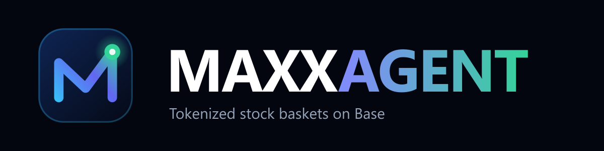

<p align="center"></p>

# MAXXAGENT

Agent-picked baskets of Coinbase tokenized stocks on Base. You buy the whole basket with USDC in one wallet confirmation, and the stocks go straight to your own wallet.

Built for the **Base Builder Quest: Stocks Maxxing Season** (Nov 5 – Dec 5, 2026), track **Agentic Stock Finance**.

> Not financial advice. Coinbase tokenized stocks are only available to persons in eligible jurisdictions outside the United States. MAXXAGENT is an independent project and is not affiliated with or endorsed by Base, Coinbase, any competition partner, or any referenced company.

## What it does

| Feature | Details |
| --- | --- |
| **Live market** | Reads all 10 Coinbase B20 stocks (NVDAc, AAPLc, TSLAc, MSFTc, METAc, GOOGLc, AMZNc, MSTRc, SNDKc, SPCXc) live from Base. It shows the Chainlink NAV (24/5), DEX price (24/7), liquidity across all pools, and the `uiMultiplier`. Charts use real history: Chainlink rounds plus DEX candles. Nothing is synthesized |
| **Basket agent** | Transparent rules score each stock on DEX-vs-NAV gap, liquidity, multiplier, beta vs risk profile, and mandate keywords. It proposes up to 5 weights. It never trades on its own |
| **One-click buy** | USDC → stocks through the KyberSwap aggregator. One EIP-5792 batch (sequential fallback), exact-amount approvals only. Routes costing more than 1.5% are refused |
| **Transaction tracker** | After a buy, receipts are read onchain to show the tokens actually received vs. quoted, plus ✓/✕ status and BaseScan links |
| **Portfolio** | Holdings, value at NAV, weights, USDC balance and activity for the connected wallet |
| **Index registry** | `StockMaxxIndexRegistry` publishes index names and weights onchain so anyone can buy the same basket. It holds no funds, charges no fees, and only the creator can update an index |
| **Attribution** | Every swap, approval and index publication carries the project's ERC-8021 Builder Code (`ox/erc8021`) |

## Trust & safety

- **Terms gate:** the first visit requires 6 explicit confirmations (non-US/OFAC, 18+, not advice, risks, non-custodial, Terms). See `/terms`.
- **Geo-block:** U.S. visitors get HTTP 451, using the host's geo header (Vercel/Cloudflare).
- **Security headers:** anti-clickjacking (`X-Frame-Options`, CSP `frame-ancestors`), HSTS, nosniff and Permissions-Policy. `x-powered-by` is removed.
- **API hardening:** per-IP rate limits, input validation (whitelisted tokens, size limits, bounded slippage), and secrets redacted from errors.
- **Private RPC:** kept server-side only (`BASE_RPC_URL`), with automatic failover to public RPCs.
- **Dependencies:** `npm audit` reports 0 vulnerabilities (PostCSS override).

## Architecture

| Path | Purpose |
| --- | --- |
| `src/app/page.tsx` | App UI: Market, Agent, Indexes, Portfolio (+ hidden team Studio at `/?studio`) |
| `src/components/TermsGate.tsx` | First-visit terms acceptance |
| `src/app/api/stocks` | Live B20 + Chainlink + DexScreener data, wallet balances (stocks + USDC) |
| `src/app/api/history` | Real price history (Chainlink `getRoundData` + GeckoTerminal OHLCV) |
| `src/app/api/agent` | Rule-based basket proposal (validated input) |
| `src/app/api/swap` | Builds USDC → stock swap calldata (whitelist, size/cost limits, Builder Code) |
| `src/app/api/indexes` | Reads published indexes from the registry |
| `src/app/api/health` | Health of RPC, Chainlink, DexScreener, KyberSwap, GeckoTerminal (for uptime monitors) |
| `src/lib/basketExecutor.ts` | Balance/allowance checks, batch or sequential execution, receipt tracking |
| `src/lib/rpc.ts` | RPC failover transport + secret redaction |
| `src/middleware.ts` | U.S. geo-block + API rate limiting |
| `contracts/StockMaxxIndexRegistry.sol` | Non-custodial index registry (allowlist of the 10 B20 stocks) |

## Quick start

```bash
npm install
cp .env.example .env.local     # fill in NEXT_PUBLIC_BASE_BUILDER_CODE (+ optional BASE_RPC_URL)
npm run dev                    # http://localhost:3000
```

Checks (no funds needed):

```bash
npm run test:contracts         # 19 registry checks via a single eth_call
npm run test:swap              # simulates USDC -> each stock swap on mainnet
npm run test:attribution       # Builder Code survives EOA, EIP-7702 and ERC-4337 batching
npm run test:e2e               # 17 user journeys in a browser with a read-only mock wallet
npm run agent:cli              # live NAV + multipliers in the terminal
```

After a real trade, check it is attributed onchain:

```bash
npm run verify:trades -- --wallet=0xYourWallet --hours=24
```

Full checklist (automated + manual, before every deploy): [TESTING.md](TESTING.md).

Production build without touching a running dev server:

```bash
NEXT_DIST_DIR=.next-audit npx next build
```

Deploy the registry (optional; needs `DEPLOYER_PRIVATE_KEY` for a fresh wallet with a little ETH):

```bash
npm run compile:contracts && npm run deploy:mainnet
```

Brand assets (logo, X banner, Open Graph image) are generated with `npm run brand` into `public/brand/`.

## Environment

| Variable | Required | Purpose |
| --- | --- | --- |
| `NEXT_PUBLIC_BASE_BUILDER_CODE` | yes | ERC-8021 Builder Code from dashboard.base.org |
| `BASE_RPC_URL` | recommended | Private Base RPC (server-only); public RPCs are rate-limited |
| `NEXT_PUBLIC_SITE_URL` | on deploy | Public URL for Open Graph images |
| `DEPLOYER_PRIVATE_KEY` | deploy only | Registry deployment |
| `NEXT_PUBLIC_INDEX_REGISTRY_ADDRESS` | auto | Written by `deploy:mainnet` |

## Known limits

- The Chainlink NAV updates 24/5 and is frozen outside market hours.
- DexScreener can miss pools, so liquidity can be understated.
- GeckoTerminal's public API is rate-limited (charts fall back to Chainlink-only).
- The aggregator may throttle bursts. The swap API retries and re-routes without private market-maker legs.
- Tokens give no voting rights. B20 policy functions are not exposed on the token contracts.
